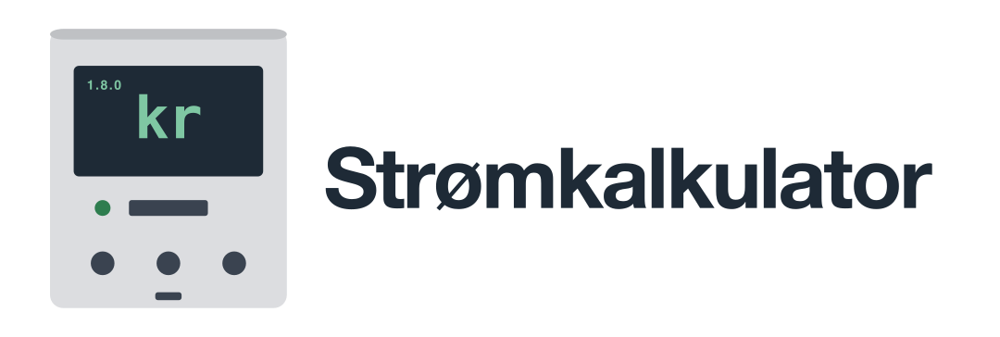
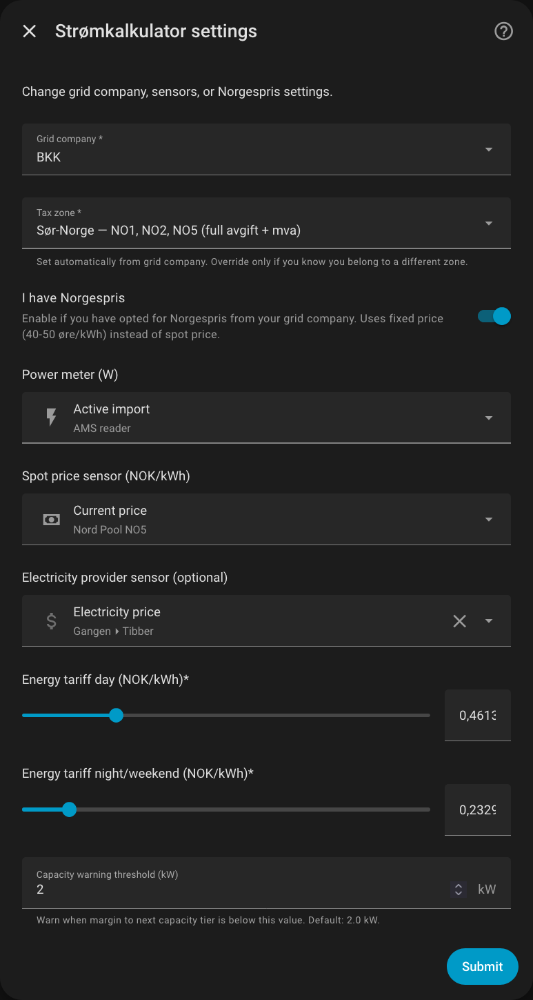
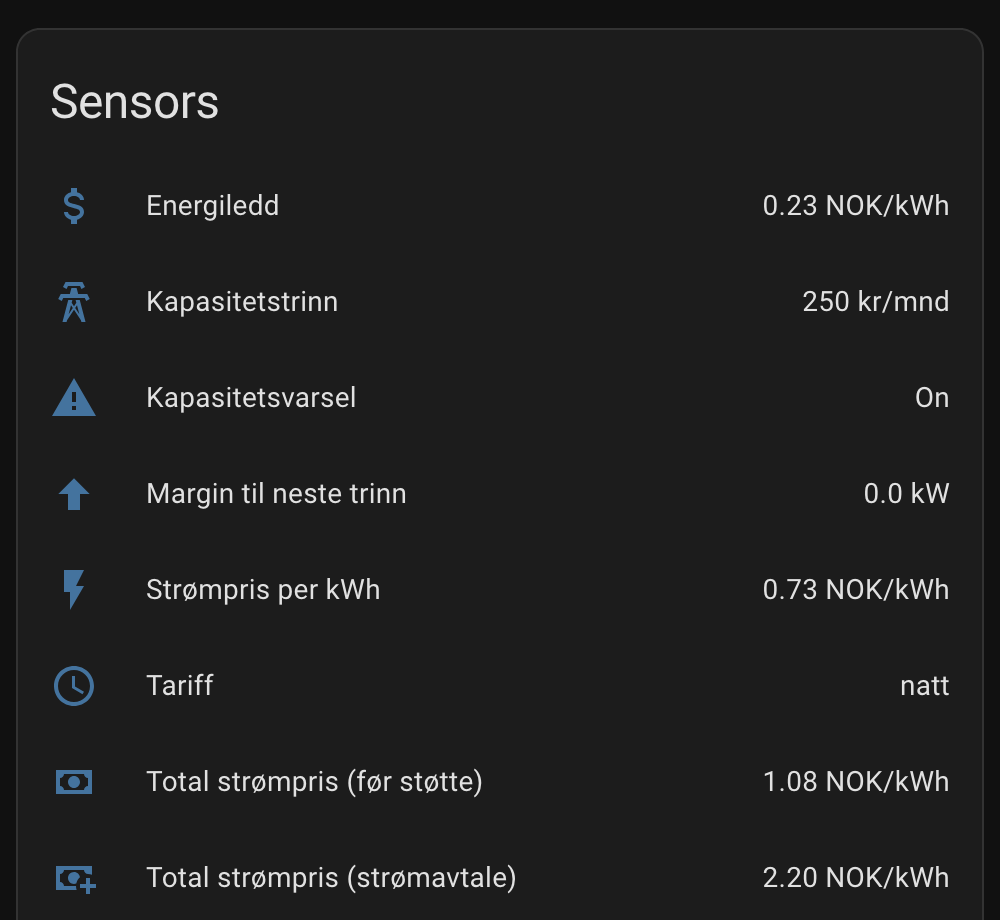
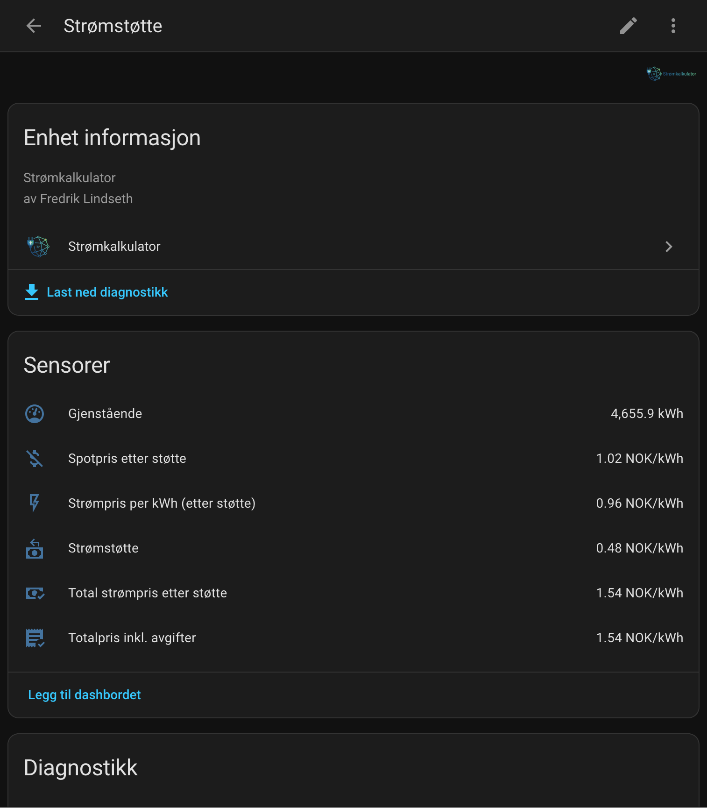
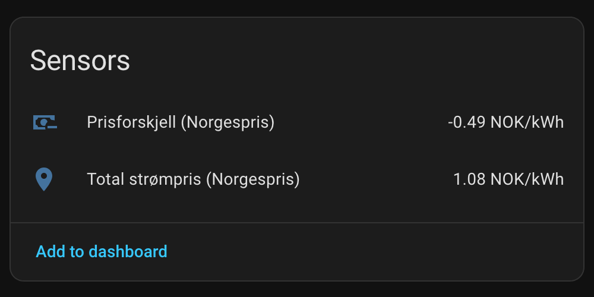
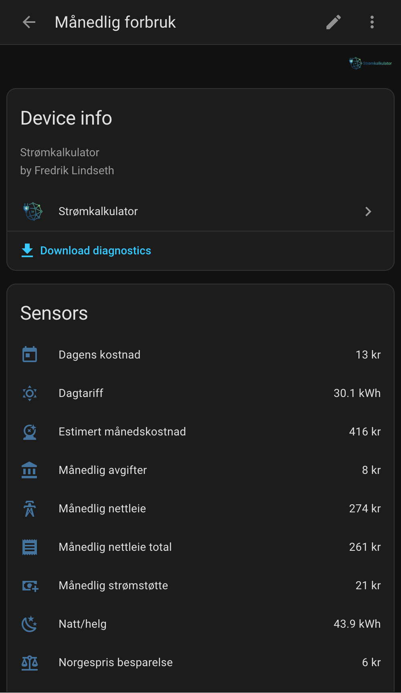
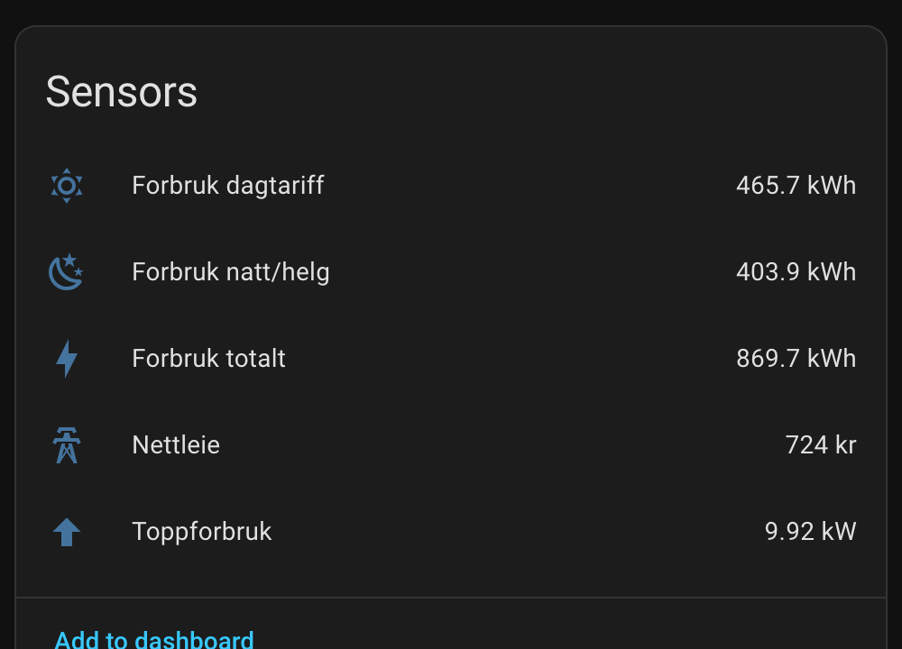

  <picture>
    <source media="(prefers-color-scheme: dark)" srcset="images/logo-dark.png">
    
  </picture>

  
  
  
  
  
  
  
  

Strømkalkulator er en Home Assistant-integrasjon som beregner nettleien fra målt forbruk og nettselskapets tariffer. Den håndterer energiledd, kapasitetstrinn, offentlige avgifter, strømstøtte og Norgespris, slik at du kan følge kostnadene og kontrollere dem mot nettleiefakturaen.

Strømpris og måledata hentes fra andre integrasjoner, for eksempel Nord Pool og en AMS/HAN-leser. Strømkalkulator bruker disse som grunnlag for nettleieberegningen og de offentlige støtteordningene.

Strømleverandørens avtalevilkår, påslag, abonnement og avtalehistorikk ligger utenfor integrasjonens ansvarsområde. Eksisterende totalpris- og kostnadsvisninger gir ikke full avregning av strømavtalen. Valg av kjøretidspunkt, prisoptimalisering og laststyring hører til [Effektvakt](https://github.com/fredrik-lindseth/hacs-effektvakt) eller brukerens automasjoner.

Beregningene er verifisert mot fakturaer og måledata. Se [resultater og datagrunnlag](docs/fakturaer/referanse.md).

## Installasjon

### Via HACS (anbefalt)

1. Klikk på knappen under for å åpne integrasjonen i HACS:
   
2. Klikk **Download**
3. Start Home Assistant på nytt

_Alternativt: HACS > Integrations > Explore & Download Repositories > Søk etter "Strømkalkulator"_

### Manuell

Kopier `custom_components/stromkalkulator` til `/config/custom_components/`

## Oppsett

**Settings > Devices & Services > Add Integration > Strømkalkulator**

### Steg 1: Velg nettselskap

Norske nettselskaper for husholdninger ligger ferdig inne med tariffer. Velg nettselskapet ditt fra nedtrekkslisten; avgiftssone (mva og forbruksavgift) settes automatisk. Du kan også velge **Egendefinert** og legge inn egne satser.

Ved registrerte fusjoner oppdateres nettselskapet automatisk, og historikken beholdes.

### Boligtype

- **Bolig (standard)**: 5000 kWh/mnd strømstøtte, 5000 kWh/mnd Norgespris-tak
- **Fritidsbolig**: ingen strømstøtte, 1000 kWh/mnd Norgespris-tak
- **Fritidsbolig (fast bosted)**: 5000 kWh/mnd på begge

Over kWh-taket for Norgespris betaler du spotpris resten av måneden. Detaljer og forskriftskilder: [beregninger.md](docs/beregninger.md#strømstøtte).

### Steg 2: Velg sensorer

- Effektmåler (W): nåværende forbruk i watt, typisk fra AMS-leser via HAN-port (f.eks. Tibber Pulse).
- Spotpris-sensor (NOK/kWh): vanligvis "Current price" fra [Nord Pool-integrasjonen](https://www.home-assistant.io/integrations/nordpool/). Den leverer eks. mva, som er det integrasjonen forventer. Har du en sensor som allerede inkluderer mva, kryss av "Spotpris-sensor leverer priser inkl. mva".
- Strømleverandør-sensor (valgfri): totalpris fra strømselskapet (f.eks. Tibber), for å se hva du faktisk betaler.

En energimåler (kWh) gir målt forbruk i stedet for et estimat fra effektsensoren. Hva integrasjonen trenger, og hvorfor: [input-sensorer.md](docs/input-sensorer.md).

### Avgiftssoner

Avgiftssonen bestemmer mva og forbruksavgift, og settes automatisk fra nettselskapet ditt. Du kan overstyre i innstillingene hvis nødvendig. Se [beregninger.md](docs/beregninger.md#offentlige-avgifter-2026) for satsene per sone.

## Devices og sensorer

Integrasjonen oppretter seks devices med til sammen 35 aktive sensorer. Diagnostikk-sensorer er deaktivert som standard og kan slås på under Settings > Devices > Entities uten at det påvirker beregningene. Blant sensorene er et kapasitetsvarsel som utløses når du nærmer deg neste (dyrere) kapasitetstrinn, med en terskel (standard 2,0 kW) du kan endre under Configure. Komplett oversikt: [sensorer.md](docs/sensorer.md).

### Nettleie

Priser og beregninger for nettleie, strømstøtte og totalpris.

### Strømstøtte

Hvor mye du får i strømstøtte (90 % over 96,25 øre/kWh).

### Norgespris

Sammenligner spotprisavtalen din med Norgespris.

### Månedlig forbruk

Forbruk og kostnader for inneværende måned, fordelt på dag og natt/helg.

### Forrige måned

Forrige måneds data for faktura-verifisering.

Vil du kontrollere egne tall mot nettleiefakturaen? Se [veiledningen for fakturakontroll](docs/fakturaer/verifiser-din-faktura.md).

### Eksport

Solcelle-eksport for plusskunder (deaktivert som standard).

Eksportinntekt bruker prisen for kvarteret energien ble levert i. Mangler et kvarter pris, for eksempel under en omstart, viser inntekt og nettokostnad kjent delbeløp, og attributtene sier hvor mye energi som mangler pris. Nettokostnad krever også kjent fastledd.

## Bruk med Energy Dashboard

Energy Dashboard trenger en forbruksmåler (kWh) fra AMS-leseren din og en kostnadskilde fra integrasjonen. Anbefalt kostnadskilde er **Akkumulert strømkostnad** (fordeler kapasitetsleddet over tid). **Totalpris inkl. avgifter** er enklere, men gir feil kapasitetsledd ved avvikende forbruk.

Steg for steg for begge alternativene: [sensorer.md](docs/sensorer.md#energy-dashboard).

## Strømstøtte og Norgespris

Med spotpris trekkes strømstøtten (90 % over 96,25 øre) automatisk fra, og sensoren "Strømstøtte" viser beløpet. Norgespris bestilles på Min side hos Elhub ([minside.elhub.no](https://minside.elhub.no)), ikke hos nettselskapet eller strømleverandøren. Har du [Norgespris](https://www.regjeringen.no/no/tema/energi/strom/regjeringens-stromtiltak/), kryss av "Jeg har Norgespris" i oppsettet: da regnes fast 50 øre (Sør-Norge) eller 40 øre (Nord-Norge) uten strømstøtte. Sensoren "Prisforskjell Norgespris" viser hvilken avtale som er billigst akkurat nå. Formler: [beregninger.md](docs/beregninger.md#norgespris).

## Begrensninger

Laget for privatbolig med eget strømabonnement. Ikke støttet:

- Næringsliv (andre stønadssatser)
- Borettslag med fellesmåling

## Ofte stilte spørsmål

### Hvorfor viser sensoren "natt" midt på dagen?

"Natt"-tariffen heter egentlig "natt/helg" og gjelder netter (22:00-06:00), hele helger og helligdager. Så på en lørdag kl. 14:00 er "natt" riktig. Full regel: [beregninger.md](docs/beregninger.md#energiledd).

### Hvorfor er "Totalpris inkl. avgifter" høyere enn spotprisen?

Spotprisen er bare strømmen. Totalpris inkluderer også nettleie (energiledd + kapasitetsledd), forbruksavgift, Enova-avgift og mva. For de fleste utgjør nettleie og avgifter 30-50 % av totalprisen.

### Strømstøtte viser 0. Er det feil?

Nei. Strømstøtte utbetales kun når spotprisen er over 96,25 øre/kWh (2026). Under terskelen er støtten 0.

### Tallene stemmer ikke helt med fakturaen?

Kontroller at riktig nettselskap, avgiftssone og sensorer er valgt. En energisensor (kWh) gir målt forbruk; uten den estimeres forbruket fra effektsensoren. Prisgrunnlag og manglende måledata kan også gi avvik. Se [veiledningen for fakturakontroll](docs/fakturaer/verifiser-din-faktura.md) og [kjente begrensninger](docs/begrensninger.md).

### Hvorfor viser Energy Dashboard feil kapasitetsledd?

Det skjer bare med prissensor-metoden (**Totalpris inkl. avgifter**): kapasitetsleddet fordeles per kWh, så Energy Dashboard ganger det opp feil ved avvikende forbruk. Løsningen er **Akkumulert strømkostnad**, som fordeler kapasitetsleddet lineært over tid. Regneeksempel og detaljer: [beregninger.md](docs/beregninger.md#totalpris).

## Dokumentasjon

[Dokumentasjonsoversikt](docs/README.md) med brukerveiledninger, fakturakontroll og utviklerdokumentasjon.

| Dokument                                    | Innhold                             |
| ------------------------------------------- | ----------------------------------- |
| [sensorer.md](docs/sensorer.md)             | Alle sensorer og attributter        |
| [beregninger.md](docs/beregninger.md)       | Formler og avgiftssoner             |
| [input-sensorer.md](docs/input-sensorer.md) | Hva integrasjonen trenger som input |
| [begrensninger.md](docs/begrensninger.md)   | Kjente begrensninger og avvik       |
| [contributing.md](docs/contributing.md)     | Oppdatere priser / rapportere feil  |
| [testing.md](docs/testing.md)               | Validere beregninger                |

Se [verifisering av utgivelser](SECURITY.md) for hvordan du kontrollerer den nedlastede filens opphav.

## Datakilder

Nettleieprisene vedlikeholdes i integrasjonen og kryssjekkes mot [fri-nettleie](https://github.com/kraftsystemet/fri-nettleie) fra kraftsystemet, som er fasiten for satsene. Dataene derfra brukes under [CC-BY-4.0](https://creativecommons.org/licenses/by/4.0/). Avgifter kommer fra skatteetaten, kapasitetstrinn-struktur fra NVE.

## Lisens

MIT
